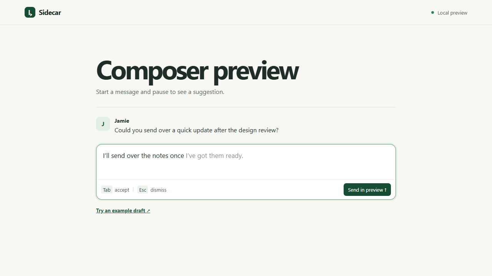

# Sidecar for Slack

Codex-style draft predictions in Slack Web. Pause while typing, then press **Tab** to accept the gray suggestion or **Esc** to dismiss it.

Inspired by [Fede Sarquis](https://x.com/fedesarquis) asking who was building this. Sidecar is an independent project.



## Try it

Install [Node.js 22+](https://nodejs.org/), then choose a mode. Both use the same browser extension and practice composer.

### Ollama mode

Install [Ollama](https://ollama.com/download), then run these commands from the project folder. The first command downloads the local model.

```sh
ollama pull qwen3:4b
npm start
```

Drafts stay on your computer. The first prediction can take a few seconds while the model loads.

### OpenAI API mode

Save your own [OpenAI API key](https://platform.openai.com/api-keys) as `OPENAI_API_KEY` in an ignored `.env.local` file in the project folder. You can also supply it through the environment. A value in `.env.local` takes precedence. The default model is `gpt-6.2-sol`. Set `OPENAI_MODEL` in the same file or environment to use a different compatible model.

```sh
npm run start:openai
```

This mode needs only Node.js and your key. It sends the current draft to the OpenAI Responses API and uses your project's API billing.

Leave the companion running, then open [the practice composer](http://127.0.0.1:4317/) and click **Try an example draft**. Stop the current companion before starting the other mode.

## Use it in Slack Web

1. In Edge or Chrome, open `edge://extensions` or `chrome://extensions`. Enable **Developer mode**, choose **Load unpacked**, and select the `extension` folder.
2. Open or refresh Slack at `https://app.slack.com`. Click the Sidecar toolbar icon, review the active provider, then click **Enable in this tab**. The toolbar badge shows **ON** for Ollama or **API** for OpenAI.
3. Type an unfinished draft such as `I’ll send over the notes once`. Pause, then press **Tab** to insert the suggestion. Send the draft through Slack as usual.

Sidecar starts off in every Slack tab. To turn it off, open the popup and click **Disable in this tab**. Reloading the tab also turns it off. If you switch providers, reload Slack or disable and re-enable predictions so the tab uses the new provider.

## What the extension sees

While enabled, Sidecar sends only the current draft to the companion on `127.0.0.1:4317`. The companion passes it to the provider you enabled. Sidecar keeps no draft log, reads no message history, and needs no Slack token. In OpenAI mode, the key stays in the companion and the API request sets `store: false`.

The first version targets English-language Slack Web in Chromium browsers. The extension has been tested in Edge against a simulated Slack composer. Compatibility in a signed-in workspace and on other operating systems still needs testing.

## License

[MIT](LICENSE) covers Sidecar’s source. Ollama and Qwen have their own licenses.
